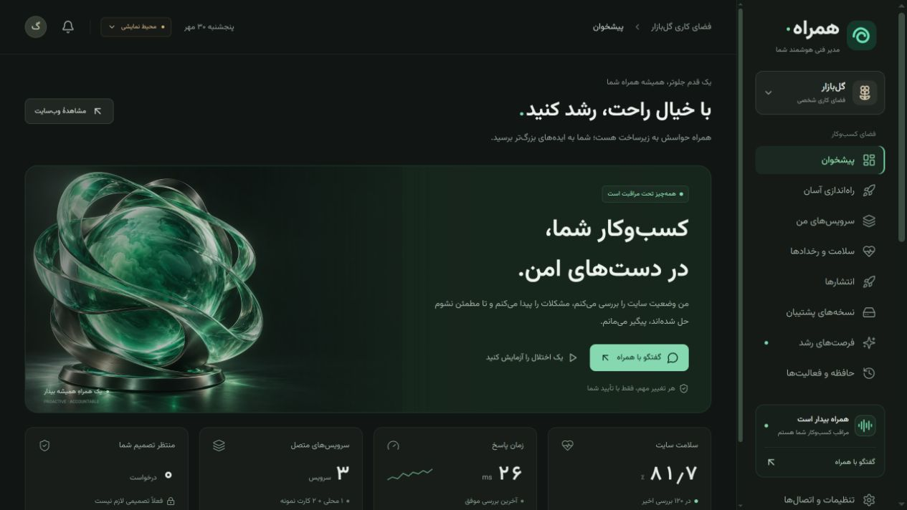

# همراه — مدیر فنی هوشمند کسب‌وکار شما

آزمون واقعی گل‌بازار روی لیارا شامل ساخت برنامه و PostgreSQL خصوصی، اتصال خودکار تنظیمات، دیپلوی، ثبت سفارش، پایش اختلال، تأیید بهبود، ری‌استارت و بررسی ماندگاری انجام شد. برنامه و دیتابیس آزمایشی پس از آزمون حذف شدند. [گزارش HTML و شواهد](docs/reports/live-test/report.html) · [ویدئوی مرور تصاویر مراحل](docs/reports/live-test/walkthrough.mp4).

یک MVP قابل اجرا برای هکاتون لیارا: **کنشگر، مسئولیت‌پذیر و قابل‌کنترل**.

همراه مستقل از گفتگو سایت را بررسی می‌کند، اختلال را پیدا می‌کند، شواهد را نگه می‌دارد، برای اقدام حساس تأیید می‌گیرد و فقط وقتی سلامت سایت **و مسیر اصلی کسب‌وکار** دوباره تأیید شدند، رخداد را می‌بندد.

رابط فارسی و راست‌به‌چپ، گرافیت و سبز یشمی، فونت محلی وزیرمتن، نماهای موبایل و دسکتاپ، بدون نیاز به سرویس خارجی برای حالت دمو.



## اجرای سریع

نیازمندی: Node.js نسخهٔ **۲۲٫۱۳ یا بالاتر** و npm.

```powershell
npm ci
Copy-Item .env.example .env
npm run dev
```

اگر `.env` را نساخته باشید هم حالت دمو با مقادیر پیش‌فرض اجرا می‌شود.

- داشبورد: [http://127.0.0.1:5173](http://127.0.0.1:5173)
- فروشگاه واقعی محلی گل‌بازار: [http://127.0.0.1:3002](http://127.0.0.1:3002)
- API و رویدادهای زنده: پورت `3001`

دستور dev هر سه بخش را اجرا می‌کند. برای تغییر کد سمت سرور، dev را دوباره اجرا کنید؛ رابط از HMR استفاده می‌کند.

## راه‌اندازی پروژهٔ خودتان

در «راه‌اندازی آسان»، لینک `https://github.com/owner/repository` بدهید یا ZIP حداکثر ۲۰ مگابایت آپلود کنید. وابستگی‌های نصب‌شده مثل `node_modules` را از ZIP حذف کنید. برای مخزن خصوصی می‌توانید ZIP بدهید یا `GITHUB_TOKEN` را فقط در `.env` سرور تنظیم کنید؛ توکن به میزبان دانلود آرشیو ارسال نمی‌شود.

همراه نسخهٔ مشخص commit را دریافت می‌کند، فایل‌ها را بدون اجرای کد تحلیل می‌کند و فریم‌ورک، دستور اجرا، پورت، نشانه‌های دیتابیس/کش و نام تنظیمات را همراه شواهد نمایش می‌دهد. موارد ناقص جلوی انتشار را می‌گیرند. در مخزن چندبرنامه‌ای، پوشهٔ برنامه را در تنظیمات اختیاری مشخص کنید. فایل‌های env، کلیدهای شناخته‌شده و دیتابیس‌های محلی از بسته حذف می‌شوند؛ مقادیر ضروری تنظیمات را در فرم امن همین جریان وارد کنید.

در مرحلهٔ آخر، نام سایت و اندازهٔ پیشنهادی را ببینید؛ پایگاه‌های دادهٔ موردنیاز و اتصال متغیرها پیشنهاد می‌شوند. کلید لیارا را یک بار در همین جریان یا «تنظیمات و اتصال‌ها» ذخیره کنید. برای مسیر معمول نیازی به پنل لیارا، ساخت دستی برنامه یا ویرایش `.env` نیست.

هزینه از پلن‌های واقعی حساب لیارا گرفته می‌شود و پیش از اجرا، جمع برآورد ۳۰ روز منابع و امکانات نمایش داده می‌شود. با تأیید شما، شبکهٔ خصوصی، برنامهٔ تازه و دیتابیس‌ها ساخته می‌شوند، رمز اتصال سمت سرور دریافت و تنظیمات موجود حفظ می‌شوند؛ سپس همان سورس تأییدشده منتشر می‌شود. تغییر تعرفه یا سورس جلوی ادامهٔ بدون تأیید را می‌گیرد. ساخت برنامه به نامی که قبلاً وجود داشته باشد انجام نمی‌شود.

پس از فعال‌شدن همان release، پاسخ سایت دو بار بررسی می‌شود. اگر پروژه مسیر مستقل آزمایش عملیات اصلی داشته باشد، نتیجهٔ آن نیز باید دو بار موفق باشد. بدون آن، وضعیت «منتشر شد؛ نیازمند بررسی عملکرد» ثبت می‌شود و سلامت کسب‌وکار ادعا نمی‌شود. مسیرهای بررسی در تنظیمات اختیاری همین فرم قابل ورودند. مراحل و شناسهٔ منابع در حافظه می‌مانند؛ خطا یا قطع برنامه باعث ساخت تکراری یا حذف خودکار نمی‌شود. [جزئیات ساخت و اتصال](docs/PROVISIONING.md).

در حالت **demo** تحلیل و بسته‌بندی واقعی است، اما سورس کاربر اجرا یا به ابر ارسال نمی‌شود؛ نتیجه با عنوان «پیش‌نمایش» ثبت می‌شود. تحلیل ایستا بدون Cursor هم کار می‌کند؛ با تنظیم کلید Cursor، توضیح تکمیلی مدل به گزارش افزوده می‌شود و ابزار خواندنی `get_project_analysis` در دسترس گفتگوست.

## سناریوی کامل دمو

1. فروشگاه محلی را باز کنید و یک سفارش آزمایشی ثبت کنید.
2. در پیشخوان «یک اختلال را آزمایش کنید» را بزنید.
3. اختلال کنترل‌شده، مسیر سفارش را واقعاً به خطای ۵۰۰ می‌رساند.
4. Worker بدون پیام در چت، پس از سه بررسی ناموفق، یک رخداد می‌سازد.
5. لاگ واقعی شامل `connection pool exhausted` بررسی و پیشنهاد ری‌استارت ثبت می‌شود.
6. اثر، هزینه، مقصد و مهلت تأیید را ببینید. **پیش از تأیید عملیاتی اجرا نمی‌شود.**
7. تأیید کنید. کنترلر فروشگاه اتصال‌های موقت شبیه‌سازی‌شده را آزاد می‌کند.
8. همراه دو بررسی موفق متوالی از سلامت و نوشتن آزمایشی سفارش با rollback می‌گیرد و رخداد را می‌بندد.

«آزمایش مسیر ناموفق» خرابی پایدار ایجاد می‌کند. ری‌استارت آن را رفع نمی‌کند؛ اقدام `failed` و رخداد `ESCALATED` می‌شود. با «بازگرداندن به حالت سالم» محیط را برگردانید.

این دمو عملیات ابر را جعل نمی‌کند: فروشگاه و SQLite محلی واقعی‌اند؛ کنترل خرابی و ری‌استارت، شبیه‌سازی محدودِ اتصال برنامه‌اند؛ CPU، RAM، سرویس فایل و انتشارهای حالت دمو داده‌های نمونه هستند. مدل زبانی در حالت دمو فراخوانی نمی‌شود و تحلیل با قواعد مشخص انجام می‌شود.

## اتصال واقعی به لیارا و Cursor

کنار دکمهٔ ذخیرهٔ هر کلید، «تست اتصال» وجود دارد: با کادر خالی کلید ذخیره‌شده و با کادر پر کلید واردشده بررسی می‌شود. تست کلید را ذخیره نمی‌کند، حالت اجرا یا تاریخچه را تغییر نمی‌دهد و حتی در حالت دمو به API واقعی درخواست خواندنی می‌فرستد. برای لیارا فهرست برنامه‌ها (`GET /v1/projects`) و برای Cursor [اطلاعات کلید](https://cursor.com/docs/cloud-agent/api/endpoints#api-key-info) (`GET /v1/me`) بررسی می‌شود. در تست Cursor مدل یا ایجنت اجرا نمی‌شود؛ موفقیت، احراز هویت API را تأیید می‌کند، نه دسترسی یا اعتبار کافی برای اجرای مدل انتخابی. خطاهای کلید، مجوز، محدودیت درخواست، شبکه و مهلت ۱۵ ثانیه جدا نمایش داده می‌شوند. کلید یا اطلاعات حساب از پاسخ سرویس به مرورگر بازگردانده نمی‌شود.

کلید Cursor را هم می‌توانید در همان صفحه، در کادر «کلید API Cursor» وارد و با «ذخیرهٔ کلید Cursor» ذخیره یا جایگزین کنید. کلید رمزگذاری می‌شود، بر مقدار `CURSOR_API_KEY` در `.env` اولویت دارد و از درخواست بعدی بدون راه‌اندازی مجدد استفاده می‌شود. ذخیرهٔ کلید، فراخوانی Cursor یا اعتبارسنجی آن را انجام نمی‌دهد؛ اعتبار در زمان استفاده بررسی می‌شود. کلید لیارا و حالت اجرا هنگام ذخیرهٔ کلید Cursor حفظ می‌شوند.

در «تنظیمات و اتصال‌ها» می‌توانید کلید API لیارا را وارد یا جایگزین کنید. کلید رمزگذاری‌شده در `data/vault` (یا `DATA_DIR/vault`) ذخیره می‌شود، بر مقدار `.env` اولویت دارد و بدون راه‌اندازی مجدد به کار می‌رود. مقدار کلید در پاسخ API، تاریخچه یا خروجی‌ها نمایش داده نمی‌شود. فایل‌های این پوشه و کلید محلی رمزگذاری را با دسترسی سیستم‌عامل محافظت کنید.

از همان صفحه، در «حالت اجرای همراه»، «واقعی» را انتخاب کنید و «ذخیرهٔ حالت» را بزنید. اتصال با کلید ذخیره‌شده بررسی می‌شود؛ در صورت خطا حالت قبلی حفظ می‌شود. تغییر حالت فوری است، پس از اجرای مجدد باقی می‌ماند و نیاز به تغییر `APP_MODE` در `.env` ندارد. بازگشت به دمو هم از همین بخش انجام می‌شود. کلیدهای اتصال حفظ می‌شوند و تاریخچهٔ هر حالت جداست. ذخیرهٔ کلید به‌تنهایی حالت را تغییر نمی‌دهد. برای پایش برنامهٔ مشخص، شناسهٔ مقصد و آدرس‌های بررسی سلامت نیز باید تنظیم شوند (از «راه‌اندازی آسان» یا تنظیمات سرور).

مسیر پیشرفته برای اتصال دستی به برنامه‌ای که از قبل وجود دارد؛ **در جریان ساخت جدید، موارد زیر خودکار تنظیم می‌شوند**. مدیر سرور در صورت نیاز می‌تواند در `.env` بنویسد:

```dotenv
APP_MODE=live
LIARA_API_TOKEN=your_liara_token
CURSOR_API_KEY=your_cursor_user_or_service_account_key
CURSOR_MODEL=composer-2.5
LIARA_APP_ID=your-app-name
LIARA_ALLOWED_APP_IDS=your-app-name
LIARA_DATABASE_ID=your-database-id
APP_HEALTH_URL=https://your-app.example/health
APP_BUSINESS_CHECK_URL=https://your-app.example/api/checkout/check
MONITOR_INTERVAL_MS=60000
```

کلیدها کافی‌اند تا احراز هویت SDK/API ممکن شود؛ برای اینکه همراه بداند **کدام برنامه** را پایش یا تغییر دهد و **چه نتیجه‌ای** را موفق بداند، شناسهٔ مقصد و URLهای بررسی هم لازم‌اند. شناسهٔ برنامه همان `project_id` یا نام برنامه در لیارا است، نه لزوماً `_id` داخلی. برای پشتیبان‌گیری شناسهٔ دیتابیس هم لازم است.

`LIARA_ALLOWED_APP_IDS` اگر خالی باشد، تغییر منابع ازقبل‌موجود مجاز نیست. جریان ساخت با تأیید هزینه، فقط برنامهٔ تازه و مشخصِ ایجادشده را در محدودهٔ همان حساب مجاز می‌کند. این اجازه در Vault ماندگار می‌شود؛ تغییر کلید حساب، مجوزهای قبلی را به حساب جدید منتقل نمی‌کند. تأیید انسانی برای عملیات حساس بعدی همچنان لازم است.

**قرارداد بررسی کسب‌وکار:** یک endpoint امن و idempotent با پاسخ HTTP موفق و JSON شامل `{"ok":true}`؛ بهتر است یک تراکنش واقعی مانند نوشتن سفارش را انجام دهد و rollback کند. صرف پاسخ ۲۰۰ از صفحهٔ اصلی، اثبات سلامت سفارش نیست. خطای HTTP، JSON نامعتبر، `ok:false` و نبود URL باعث شکست تأیید می‌شوند. endpoint سلامت نیز نباید در پاسخ موفق `ok:false` یا `healthy:false` داشته باشد.

سرویس را بعد از تنظیم فایل دوباره اجرا کنید. داده‌های `demo` و `live` جدا نگه داشته می‌شوند. در محیط واقعی فروشگاه محلی خودکار اجرا نمی‌شود.

### Cursor SDK محلی

از بستهٔ رسمی `@cursor/sdk@1.0.40` استفاده می‌شود، با `Agent.create({ local: ... })` و ادامهٔ گفتگو از طریق `Agent.resume`.

- حلقهٔ ایجنت روی Node.js محلی اجرا می‌شود؛ inference توسط سرویس میزبانی‌شدهٔ Cursor انجام می‌شود.
- فقط ابزارهای MCP تعریف‌شده در `local.customTools` مجازند.
- shell، ویرایش، حذف، خواندن آزاد فایل‌ها، وب و subagent مسدودند.
- ابزار `request_action` فقط درخواست تأیید می‌سازد؛ نمی‌تواند تأیید کند یا تغییر را اجرا کند.
- تنظیمات محیطی Cursor با `settingSources: []` بارگذاری نمی‌شوند.
- کلیدها سمت سرور می‌مانند. حافظهٔ SDK از `JsonlLocalAgentStore` و حافظهٔ محصول از SQLite استفاده می‌کند.
- درخواست‌ها در هر ایجنت سریالی‌اند و اجرا قابل لغو با timeout است.

مدل انتخابی باید برای حساب شما در دسترس باشد. اگر نبود، `CURSOR_MODEL` را به شناسهٔ مجاز حساب تغییر دهید. اتصال زنده بدون کلیدهای واقعی آزمایش نشده است؛ نصب، import و typecheck SDK بررسی شده‌اند.

## معماری کوتاه

| بخش          | پیاده‌سازی                                                                              |
| ------------ | --------------------------------------------------------------------------------------- |
| رابط         | React 19، TypeScript، Vite، Tailwind 4، Radix Dialog/AlertDialog، Recharts، Lucide      |
| API          | Express 5، اعتبارسنجی Zod، SSE برای وضعیت زنده                                          |
| پایش         | Worker زمان‌بندی‌شده در فرآیند سرور؛ مستقل از مرورگر و چت                               |
| ایجنت        | Cursor SDK محلی با ابزارهای محدود؛ قواعد صریح در دمو                                    |
| ابزار لیارا  | Adapter با مسیرهای مستندشدهٔ OpenAPI و timeout شبکه                                     |
| سیاست اجرا   | allowlist مقصد، تأیید انسانی، هش پارامترها، انقضای ۱۵ دقیقه‌ای، جلوگیری از اجرای تکراری |
| راستی‌آزمایی | دو بررسی موفق متوالی سلامت + مسیر کسب‌وکار؛ فعال‌شدن همان release برای انتشار ابری      |
| حافظه        | SQLite با WAL + حافظهٔ JSONL رسمی Cursor؛ ثبت پیام، رخداد، شواهد، تأیید و نتیجه         |
| گزارش        | تاریخچهٔ دارای زنجیرهٔ SHA-256 و خروجی JSON                                             |
| فروشگاه دمو  | Express + SQLite؛ ثبت سفارش، بررسی نوشتن با rollback، خرابی و پشتیبان واقعی محلی        |

مسیر رخداد:

`DETECTED → INVESTIGATING → PLAN_READY → AWAITING_APPROVAL → EXECUTING → VERIFYING → RESOLVED`

در شکست یا نبود شواهد کافی: `ESCALATED`؛ با رد کاربر: `REJECTED`. پس از crash در میانهٔ اجرا، عملیات خودکار تکرار نمی‌شود و نتیجه نامشخص علامت می‌خورد.

جزئیات بیشتر: [معماری](docs/ARCHITECTURE.md)، [قرارداد APIها](docs/API_CONTRACT.md)، [راهنمای دمو](docs/DEMO.md).

## امکانات قابل استفاده

- پیشخوان فارسی و واکنش‌گرا، نمودار دادهٔ واقعی بررسی‌های محلی و فعالیت زنده.
- راه‌اندازی سه‌مرحله‌ای با ZIP یا GitHub، تحلیل کد واقعی، پیشنهاد مستند و انتشار نسخهٔ تأییدشده روی مقصد موجود.
- فهرست سرویس‌ها و لاگ‌های فیلترشده.
- تشخیص مستقل اختلال، شواهد و مسیر زمانی هر رخداد.
- تأیید/رد عملیات حساس همراه با نمایش اثر و هزینه.
- ری‌استارت برنامه از API واقعی لیارا؛ یا کنترلر محلی در دمو.
- انتشار سورس واردشده با پلتفرم و پورت تشخیص‌داده‌شده، پس از تأیید؛ پیش از اعلام موفقیت همان release باید فعال شده باشد.
- نمایش انتشارها و پشتیبان‌های لیارا؛ درخواست تهیهٔ پشتیبان ابری.
- تهیه و بازیابی پشتیبان واقعیِ سفارش‌های فروشگاه **محلی** با نسخهٔ ایمنی.
- گفتگو و تاریخچهٔ پایدار؛ فیلتر و جستجوی فعالیت‌ها، خروجی حافظه و audit.
- مدیریت پایش، نام کسب‌وکار و نمایش اعلان‌ها.
- پیشنهادهای کش و ایمیل با مسیر فعال‌سازی **نمایشی** و توضیح محدودیت‌ها.

## محدودیت‌های صریح

- این نسخه یک **MVP هکاتونی تک‌کاربره** است، نه تأییدیهٔ آمادگی برای زیرساخت حساس تولیدی.
- ساخت برنامه و دیتابیس‌های PostgreSQL/MySQL/MongoDB/Redis و تنظیم env در جریان راه‌اندازی تأییدشده پیاده‌سازی شده‌اند. ساخت حساب لیارا، شارژ بانکی، ایمیل واقعی و اصلاح خودکار کد هنوز ارائه نشده‌اند. کارت‌های فرصت رشد مسیر مستقل نمایشی دارند.
- تغییر env در این جریان فقط روی برنامهٔ تازهٔ تأییدشده و با حفظ تنظیمات خواندنی موجود انجام می‌شود. تغییر منابع موجود، حذف سرویس و شل ابری ابزار اجرایی ندارند. SDK مجوز ویرایش آزاد پروژه یا تأیید هزینه به‌جای کاربر را ندارد.
- بازیابی ابری در قرارداد OpenAPI بررسی‌شده یافت نشد و در live غیرفعال است. این به معنی نبود آن قابلیت در تمام ابزارها یا پنل لیارا نیست.
- DNS و تغییرات در ایرنیک دستی‌اند؛ [راهنمای رسمی اتصال دامنه](https://docs.liara.ir/paas/domains/add-domain/).
- تشخیص Node.js، Next.js، Nuxt، Vite، Python، PHP، Docker و سایت استاتیک پیاده‌سازی شده؛ پروژه‌های Python یا فرانت‌اندِ نیازمند build فعلاً برای انتشار خودکار به Dockerfile کامل نیاز دارند. workspaceهای پیچیده باید بسته‌بندی مستقل داشته باشند. rollback ابری ارائه نشده است.
- سرویس‌های خارجی از روی شواهد ایستا پیشنهاد می‌شوند؛ استفادهٔ قطعی یا درستی اتصال آن‌ها پیش از اجرا تضمین نمی‌شود. منابع تخمینی‌اند و قیمت یا پلن خرید خودکار نداریم.
- حداکثر ZIP بیست مگابایت، حجم بازشده هشتاد مگابایت، هر فایل هشت مگابایت و شمار ورودی‌ها چهار هزار است. سی پروژه در حافظه نگه داشته می‌شود؛ پاک‌سازی آرشیوها فعلاً با مدیریت سرور انجام می‌شود. مسیرهای ناامن، لینک‌ها و فایل‌های ویژه رد می‌شوند. فیلتر فایل جایگزین ممیزی اسرار hardcodeشده در کد نیست.
- نمونهٔ ابری `demo/site` سفارش‌ها را در حافظهٔ موقت نگه می‌دارد؛ برای استفادهٔ واقعی باید DB پایدار اضافه شود. نمونهٔ محلی دادهٔ پایدار SQLite دارد.
- پذیرش درخواست پشتیبان در ابر به عنوان «فایل آماده» گزارش نمی‌شود؛ وضعیت فایل از لیست پشتیبان‌ها بررسی می‌شود.
- بررسی منابع از طریق ابزار `get_metrics` در اختیار Cursor است. نمودار پیشخوان، زمان پاسخ probeهاست؛ CPU/RAM نمونه به‌عنوان متریک واقعی ابر نمایش داده نمی‌شوند.
- Notification فقط داخل داشبورد است؛ ارسال پیامک، ایمیل و push خارجی متصل نیست.
- پایش تا زمانی ادامه دارد که فرآیند سرور روشن باشد. چند replica و هماهنگی صف توزیع‌شده پیاده‌سازی نشده‌اند.
- زنجیرهٔ هش تغییر تاریخچه را قابل‌تشخیص می‌کند؛ در برابر مهاجم دارای دسترسی کامل به فایل DB تضمین تغییرناپذیری نیست.
- فیلتر لاگ دفاع اولیه است، نه طبقه‌بندی کامل دادهٔ حساس؛ پیش از اتصال محیط واقعی، دادهٔ مجاز برای ارسال به مدل را بررسی کنید.

## اجرا برای ارائه یا نصب پایدار

```powershell
npm run build
npm start
```

رابط و API روی [http://127.0.0.1:3001](http://127.0.0.1:3001) ارائه می‌شوند. در حالت demo، فروشگاه محلی نیز خودکار اجرا می‌شود. `npm run demo` فقط برای اجرای جداگانهٔ فروشگاه است و نباید هم‌زمان با launcher روی همان پورت اجرا شود.

پوشهٔ `data/` را حفظ کنید. تغییر یا حذف این پوشه، حافظهٔ محصول و پشتیبان‌های محلی را از بین می‌برد.

برای Docker، در `.env` یک `DASHBOARD_PASSWORD` تصادفی حداقل ۲۰ کاراکتری بگذارید:

```sh
docker compose up --build -d
```

ورود با HTTP Basic است؛ نام کاربری دلخواه و گذرواژهٔ تنظیم‌شده. در دسترسی خارج از دستگاه، HTTPS را در reverse proxy تنظیم کنید. Compose پورت را فقط روی localhost باز می‌کند و volume پایدار دارد. فایل Docker در این محیط صرفاً به‌عنوان پیکربندی تحویل داده شده؛ نتیجهٔ اجرای Docker در گزارش بررسی ذکر می‌شود.

## بررسی کیفیت

```sh
npm test
npm run build
```

۱۸ آزمون شامل تشخیص بدون چت، تأیید دقیق و یک‌باره، نتیجهٔ موفق و ناموفق، بازیابی واقعی اطلاعات، رد و انقضای تأیید، ماندگاری حافظه، بازیابی پس از crash، کشف دستکاری audit، حذف مقادیر محرمانه، قرارداد ابزار لیارا و بسته‌بودن قابلیت‌های live پشتیبانی‌نشده وجود دارد.

گزارش بررسی رابط و خروجی تست‌ها: [VALIDATION.md](docs/VALIDATION.md).

## منابع رسمی

- [مستندات لیارا](https://docs.liara.ir/references/api/about/)
- [OpenAPI رسمی PaaS](https://github.com/liara-cloud/openapi/blob/main/spec/paas.yaml)
- [OpenAPI رسمی DBaaS](https://github.com/liara-cloud/openapi/blob/main/spec/dbaas.yaml)
- [Cursor TypeScript SDK](https://cursor.com/docs/sdk/typescript)
- [راهنمای رسمی اتصال دامنه](https://docs.liara.ir/paas/domains/add-domain/)

دموی بی‌صدا و متن پیشنهادی روایت در [راهنمای دمو](docs/DEMO.md) قرار دارند.

تصویر شاخص با ابزار داخلی ImageGen تولید شده؛ مسیر و prompt در [ASSETS.md](docs/ASSETS.md) ثبت است.
